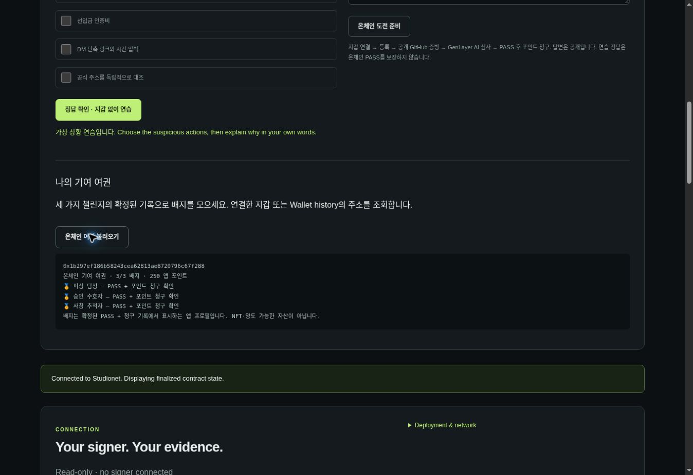

# Trap Hunt and Contribution Passport

Three fictional security-learning challenges are available without connecting a wallet: airdrop phishing, NFT approval traps, and fake support messages. Each has three dangerous choices and one safe response. Practice scoring is deterministic, runs locally, and is explicitly not AI consensus. Practice cannot create an on-chain badge.

To earn a badge, write your own explanation (80+ characters), connect a signer, choose **온체인 도전 준비**, then use the existing workspace: register, publish the downloaded wallet-bound evidence at a pinned public GitHub commit, request GenLayer AI review, and claim points after PASS. Each challenge awards 50 non-transferable app points once per wallet. Practice success never guarantees AI PASS. Never include real secrets.

The passport scans every 25-record page of finalized submissions for the requested wallet. A challenge badge requires that challenge's PASS record AND claimed=true. PASS without a claim is shown as pending. Badges are derived profile labels, not newly minted NFTs. It reads the same deployed V4 source and existing ledger; no replacement contract or manual verdict override is introduced.

Daily starting scenario uses the day of month in Asia/Seoul. All three scenarios remain selectable. Practice progress is stored only on this device. No financial rewards or human uniqueness are claimed.

Local validation: 33 automated tests (11 JavaScript and 22 contract host tests), including all-choices rejection and badge gating. Network and hosted browser verification are recorded separately when completed.

## Verified live challenge

Quest #3 (airdrop) → submission #4 → actual AI PASS → successful finalized claim. The test wallet's balance increased from its previous 100 to 150 points. All three quest creations, registration, evaluation and claim (6 transactions) were individually reread and proved FINALIZED / MAJORITY_AGREE / SUCCESS. Deployed source still matches the published V4 byte for byte. See [machine-readable live evidence](play-live-results.json). This initial snapshot tested one challenge end to end. The complete three-challenge verification is documented below. Personal wallet extension signing remains untested.

## Hosted browser verification

On the published app, all three scenarios rendered, accepted their correct choices and displayed the expected explanations without a wallet. Selecting every option correctly failed. The UI rejected a short explanation and a disconnected on-chain preparation attempt. With a temporary signer, preparation selected quest #5 and copied the typed Fake Support explanation into the contribution editor. No transaction is sent by preparation itself.

The passport queried the real test wallet `0x1b297ef186b58243cea62813ae8720796c67f288` and displayed 1/3 badges, 150 points, and only the earned phishing badge. Practice success did not award the other badges. Personal wallet extension signing remains untested. This was the initial browser snapshot; the later complete run below supersedes its 1/3 completion state.

## Complete three-challenge verification

All three challenges now have finalized registration, actual AI PASS and successful point claims for the same sandbox test wallet. Airdrop uses submission #4, NFT approval #5, and fake support #6. Each earned 50 app points: 150 challenge points, plus 100 earlier staking points, gives the checked final balance of 250. The passport derives all three badges from these exact finalized records. Deployed contract source still matches byte for byte.

The six additional NFT/support transactions all finalized with MAJORITY_AGREE and SUCCESS. See [all-challenge machine-readable results](all-challenges-results.json), plus the earlier [airdrop results](play-live-results.json). These are successful scripted network flows; the public browser independently reads their resulting state. They do not replace personal wallet extension signature testing.

The hosted public browser independently displayed all 3/3 badges and 250 app points after this complete run. A different wallet with no successful challenges displayed 0/3 badges and 0 points. No browser wallet signature was required to inspect these public records.

