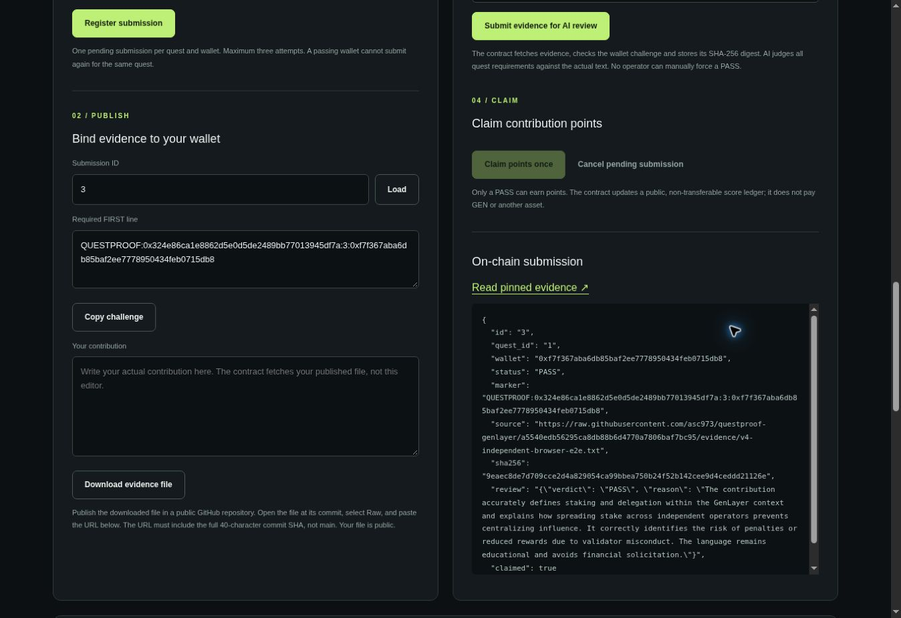

# QuestProof V4 — verified release

Verified on 2026-10-21. **31 local tests, 13 live integration checks and a hosted browser end-to-end flow passed.** This is Studionet development evidence, not Projects acceptance or a production security audit.

## Active deployment

- Network: Studionet, chain ID 61999
- Contract: [0x324E86Ca1E8862d5e0d5de2489bb77013945Df7a](https://explorer-studio.genlayer.com/address/0x324E86Ca1E8862d5e0d5de2489bb77013945Df7a)
- Deploy transaction: [0xd3577ef22438b7faab2974a35f68e3be28cb6fcb7a2fbd690ec2af61f2e02e21](https://explorer-studio.genlayer.com/tx/0xd3577ef22438b7faab2974a35f68e3be28cb6fcb7a2fbd690ec2af61f2e02e21)
- Exact source: [questproof_v4.py](../contracts/questproof_v4.py)
- Source SHA-256: `febed55e218c8d2503540700865f19d275b851c6aaf1cbac7c60711fab2af23f`
- Deployed code downloaded with `getContractCode` and matched **byte-for-byte** with the checked-in source.
- [Deployment manifest](../deployment.json)

## What actually passed

| Layer | Verification | Result |
|---|---|---|
| Local | 22 Python contract invariant tests with a mocked GenLayer host; 9 SDK receipt-classification tests | 31 passed; these alone are NOT consensus evidence |
| Live RPC | Full-consensus contract calls; source retrieval; real structured LLM calls; independently reproduced verdicts; permissions; single claim and balance checks | 13 checks passed; 18 transactions re-read at FINALIZED |
| Public browser | Open GitHub Pages, generate temporary in-memory signer, read quests, register, load challenge, publish pinned evidence, submit review, inspect PASS, claim and read 100 points | 3 successful FINALIZED writes; final record claimed=true |
| Source | Compare deployed code against repository source and SHA-256 manifest | Exact match |
| Build | `npm run build` bundles pinned GenLayerJS 1.1.8 and Viem 2.38.5 | Passed |

Machine-readable evidence: [live integration results](v4-live-results.json), [hosted browser results](v4-browser-results.json). The browser test was performed on https://asc973.github.io/questproof-genlayer/ with a separate in-memory signing account, not by mocking RPC responses or wallet APIs.

## Consensus implementation

The contract retrieves the commit-pinned public file and agrees on its exact content, verifies the contract/submission/wallet-specific first-line marker, and evaluates the original contribution against immutable quest rules.

`analyze()` calls the model with structured JSON output and validates/canonicalizes its schema. Each validator then calls `analyze()` independently on the same original source. The custom `run_nondet_unsafe` validator accepts only the same exact qualification verdict. It does not turn approval of another review into participant PASS, and it does not merely check the leader's JSON shape. Explanations can differ. A mismatch cannot commit state. This invariant has a regression test.

The API never provides an organizer PASS override. Points require a stored PASS and can be claimed once by the submitting wallet.

## Live integration assertions

- PASS: unauthorized quest creation
- PASS: parallel duplicate registration
- PASS: claim before PASS
- PASS: other wallet cannot attach evidence
- PASS: mutable branch URL rejected
- PASS: positive AI review
- PASS: adversarial injection rejected by real AI
- PASS: other wallet cannot claim
- PASS: passing wallet earns exactly 100 points
- PASS: duplicate claim rolls back without extra points
- PASS: failed review cannot earn points
- PASS: passing wallet cannot repeat quest
- PASS: review cannot be repeated

## Finalized live transactions

| Method | Transaction | Execution | Consensus |
|---|---|---|---|
| deploy | [0xd3577ef224…](https://explorer-studio.genlayer.com/tx/0xd3577ef22438b7faab2974a35f68e3be28cb6fcb7a2fbd690ec2af61f2e02e21) | SUCCESS | MAJORITY_AGREE |
| create_quest | [0x15d1426e13…](https://explorer-studio.genlayer.com/tx/0x15d1426e13494dd870cfd390b464b9119f0d1b0856a5e551218418d5ec7745ca) | SUCCESS | MAJORITY_AGREE |
| create_quest | [0xd4c403cda6…](https://explorer-studio.genlayer.com/tx/0xd4c403cda6f7dcc8637043dc74c2a483f788e7ea59ccc7630d54c7afddb982e4) | SUCCESS | MAJORITY_AGREE |
| register_submission | [0xf26fec103c…](https://explorer-studio.genlayer.com/tx/0xf26fec103c8a6313ae62ad25a359d8c74cd13e389b9f4009440e6fe7d5dda2b1) | SUCCESS | MAJORITY_AGREE |
| register_submission | [0x38565f0e2e…](https://explorer-studio.genlayer.com/tx/0x38565f0e2eefcbb44b867d2f67af60c14ade4efc8cd3d1c0803a2b341fb3b148) | SUCCESS | MAJORITY_AGREE |
| create_quest | [0x840126cb36…](https://explorer-studio.genlayer.com/tx/0x840126cb36a0c854efca7c1f701232525e5ff35a0914c4b5538a3010f3e64f5e) | ERROR | MAJORITY_AGREE |
| register_submission | [0xcb61196b9f…](https://explorer-studio.genlayer.com/tx/0xcb61196b9fcb745ca8b8d7384c410e0541f3a614d5613c9328a1515cd489efaa) | ERROR | MAJORITY_AGREE |
| claim_points | [0x325773f680…](https://explorer-studio.genlayer.com/tx/0x325773f6808adfa13324b25d60293b10d34fd44fc715586be87927c36145f67a) | ERROR | MAJORITY_AGREE |
| evaluate_submission | [0x05256ea788…](https://explorer-studio.genlayer.com/tx/0x05256ea78846fe0d6d615c6629ae81bb824bb656d4d13ec214d69ff9025fece3) | ERROR | MAJORITY_AGREE |
| evaluate_submission | [0x0970658998…](https://explorer-studio.genlayer.com/tx/0x0970658998161a6011a364e9470b43b4d56b467dee7bb5376aba62d29bf100b8) | ERROR | MAJORITY_AGREE |
| evaluate_submission | [0x9045e7ba7b…](https://explorer-studio.genlayer.com/tx/0x9045e7ba7bae5faf72e377ec606f5684d94a23046a99e5b983298ada9428d56f) | SUCCESS | MAJORITY_AGREE |
| evaluate_submission | [0xdd82cf174d…](https://explorer-studio.genlayer.com/tx/0xdd82cf174daa80f19bb448917559f1d41e4adc96d87918684054d9c90be5185b) | SUCCESS | MAJORITY_AGREE |
| claim_points | [0x5a39d685d3…](https://explorer-studio.genlayer.com/tx/0x5a39d685d3bafa0e4e6e995ca7e49e7812ed83682f719eb81a5c2a161ffe4c2d) | ERROR | MAJORITY_AGREE |
| claim_points | [0x152dcb8835…](https://explorer-studio.genlayer.com/tx/0x152dcb8835527839bd841ac734141709c0e7cd34f678f8f285842e624cc4665a) | SUCCESS | MAJORITY_AGREE |
| claim_points | [0xafcda14fb2…](https://explorer-studio.genlayer.com/tx/0xafcda14fb28b25e53e1a8b07b867aa617cfc1a3d9a72c22d1b2e9fc0c5eb4d98) | ERROR | MAJORITY_AGREE |
| claim_points | [0x2778448d20…](https://explorer-studio.genlayer.com/tx/0x2778448d2022aa4e89e5f3733377248a4081659ad913275049160af9da8e0a44) | ERROR | MAJORITY_AGREE |
| register_submission | [0x0eeff9cc0e…](https://explorer-studio.genlayer.com/tx/0x0eeff9cc0e6d66ebb37334c7f16aede09480d452cdb381d13099006dda609995) | ERROR | MAJORITY_AGREE |
| evaluate_submission | [0x6ff1058dcf…](https://explorer-studio.genlayer.com/tx/0x6ff1058dcf55db186f51ac05f2bba0852bec1c3723e6a856fdc74c4d1ef08094) | ERROR | MAJORITY_AGREE |

Expected negative cases are finalized ERROR/rollback outcomes. They are successful *rejection tests*, not successful writes. Finalization without execution success is never counted as a completed positive action.

## Hosted browser evidence

- Register: [0x5e6dfd77778811b4840911968806fedf9be7d3c18d67cda21f61f40d50fdc250](https://explorer-studio.genlayer.com/tx/0x5e6dfd77778811b4840911968806fedf9be7d3c18d67cda21f61f40d50fdc250) — FINALIZED, successful execution.
- AI review: [0x0ca2fb963640b9f30f7a8f86d517db85d478a06fe6f8fefd3a0746d9576df844](https://explorer-studio.genlayer.com/tx/0x0ca2fb963640b9f30f7a8f86d517db85d478a06fe6f8fefd3a0746d9576df844) — FINALIZED, successful execution.
- Point claim: [0x23f0240a97834b761c69c6812f57ea0c84ae9f1b07cc3844737311227e59268b](https://explorer-studio.genlayer.com/tx/0x23f0240a97834b761c69c6812f57ea0c84ae9f1b07cc3844737311227e59268b) — FINALIZED, successful execution.

Browser signer: `0xf7f367aba6db85baf2ee7778950434feb0715db8`. Submission #3: PASS, claimed=true, balance=100. The participant used for automated tests is a different signer; it also holds exactly 100 points.

## Limitations and exact security claims

- File-to-signer binding is **not verified GitHub identity**, legal identity, human uniqueness, or proof of global originality. The challenge is public, not a secret credential. The same exact evidence file cannot be claimed through a different wallet because its marker and the signed caller must match.
- Points are non-transferable application state, not tokens, money, redeemable value or promised future rewards. No token transfers are implemented.
- A personal browser-wallet extension was unavailable in the QA browser. The EIP-1193 connect/network-switch/signing path is implemented, but **external personal-wallet signing has not been manually verified**. The temporary-browser-signer path did make real signed transactions.
- The public example organizer is a temporary test account. Visitors can deploy their own source-matched workspace from the app and become its organizer. A browser wallet is appropriate for persistent ownership; temporary session keys disappear on refresh.
- Studionet can reset. Model/network failures can leave a submission pending without a stored verdict. The UI retains transaction IDs and supports tracking resumption rather than automatic duplicate writes.
- AI has residual error and prompt-injection risk. The tested adversarial sample failed as expected; no universal immunity or professional audit is claimed.
- No mission resubmission was performed by the agent.

## Superseded candidates — not active evidence

- `0x7637Aa317451975eDa14CF9E0Da9C6c5Eb5e7514`: AI reason exceeding 800 characters rolled back safely
- `0x6112dDFBC7114504098bF4Bd680f3920a3E290Fd`: Hosted browser AI response used markdown wrapping and safely rolled back; replaced by structured JSON and canonical parsing
- `0x2E0aF0E7312f47f4492542302dC9b5B16BcE7487`: Non-comparative template judged a review instead of original evidence and stored incorrect PASS in adversarial test. Not a successful release.

Earlier successful checks are not substituted for the final release results. The active contract is the one in deployment.json above.

## Hosted browser screenshot

## Organizer browser deployment and quest creation

The published browser app also deployed a separate organizer workspace, verified exact source matching, then created quest #1 with 25 points. Both transactions reached FINALIZED with successful execution. This extra smoke test does not replace the primary demo deployment. See [machine-readable organizer results](v4-organizer-browser-results.json).

## Trap Hunt expansion

The same source-matched deployment now hosts three additional security learning quests. All three were tested through finalized registration, actual AI PASS and claims. See [complete participation and verification](PLAY.md) and [all-challenge final results](all-challenges-results.json). These extend, rather than replace, the original core verification.
